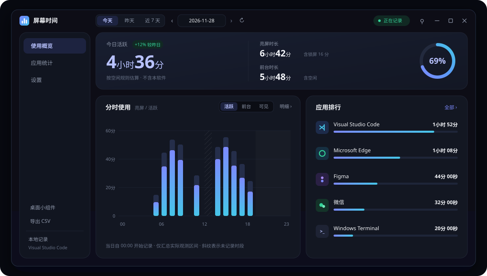
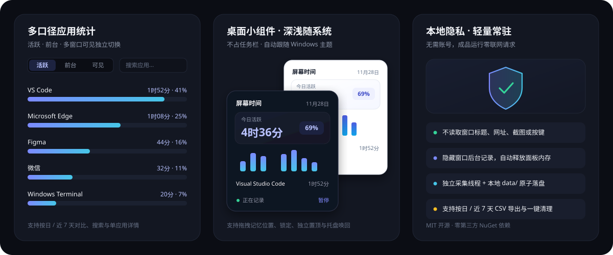

<div align="center">

# ScreenTime for Windows

**A local-first, privacy-respecting, lightweight Windows screen time tracker**

[简体中文](README.md) | [English](README.en.md)

[](https://github.com/lsaac335/windows-screen-time-open-source/releases/tag/v0.5.3)
[](https://github.com/lsaac335/windows-screen-time-open-source/releases/tag/v0.5.3)
[](https://dotnet.microsoft.com/download/dotnet/8.0)
[](LICENSE)

[Download for Windows x64](https://github.com/lsaac335/windows-screen-time-open-source/releases/tag/v0.5.3) · [English User Guide](docs/USER_GUIDE.en.md) · [Contributing](CONTRIBUTING.md) · [Issues](https://github.com/lsaac335/windows-screen-time-open-source/issues)

</div>

---



*Note: Illustration with sample data. The app UI is currently in Chinese; the [English User Guide](docs/USER_GUIDE.en.md) maps every English description to the corresponding Chinese control labels.*

---

## Table of Contents

- [Overview](#overview)
- [Core Features](#core-features)
- [Understanding the Metrics](#understanding-the-metrics)
- [Quick Start & Upgrading](#quick-start--upgrading)
- [Data Storage & Privacy](#data-storage--privacy)
- [Architecture & Project Structure](#architecture--project-structure)
- [Build & Validation](#build--validation)
- [Version Highlights & Current Limits](#version-highlights--current-limits)
- [Contributing & License](#contributing--license)

---

## Overview

**ScreenTime** is a portable, local-first Windows desktop application (current version **v0.5.3**) that tracks **screen-on time**, **foreground app time**, **estimated active time**, and **multi-window visible time**. It is designed around transparency, privacy, and low background overhead:

- **100% local, zero surveillance**: No account required and no telemetry or cloud uploads. The tracker never reads window titles, website URLs, chat contents, screenshots, or keystroke contents.
- **Clear, honest metrics**: Keeps screen-on, foreground, active, and visible time strictly separate, and marks missing recording periods explicitly instead of fabricating data.
- **Native feel, light footprint**: Built with WPF and native Windows APIs, featuring a minimalist Obsidian dark/light theme that follows Windows automatically, a taskbar-free desktop widget, and on-demand dashboard creation/disposal for quiet background recording.

---

## Core Features



### 1. Minimalist Interface & Visual Analytics

- **Bento Overview Dashboard**: Displays daily or seven-day summaries, an **activity-to-screen-on ring** (`ActivityRing`), an **hourly/daily usage chart** with a dedicated period breakdown window (`ChartDetailsWindow`), and a **top apps ranking** with real application icons.
- **App Statistics & Comparison**: Switch between **Today, Yesterday, a specific date, or the last 7 days**. Compare the top 10 apps on a shared zero-based horizontal bar chart, filter both the chart and full paginated list (25 items/page) with live search, and inspect per-app hourly breakdowns and seven-day trends.
- **Obsidian Light & Dark Themes**: Follows the Windows app theme automatically via system notifications (zero polling, no restart required), or can be pinned manually to Light or Dark. Synchronizes the dashboard, desktop widget, title bar, open detail windows, and custom system tray menu.

### 2. Multi-Metric Precision Tracking

- **Independent Collection Thread**: Runs on a dedicated STA thread listening to WinEvent foreground transitions, attributing time using original event timestamps with one-second reconciliation so UI work never stalls timing.
- **Configurable Idle Filtering & Per-App Overrides**: Excludes inactivity beyond a configurable threshold from active time (default **5 minutes**; options: `1 / 3 / 5 / 10 / 15 / 30` min). Individual apps can override the global threshold or be set to always count while in the foreground.
- **Multi-Window Visible Time**: Tracks side-by-side windows and multi-monitor setups by estimating exposed window rectangles in Z-order—filtering out minimized, fully occluded, off-current-desktop, utility-overlay, and barely exposed windows. Multiple windows of the same app merge into a single timer. Can be disabled independently.
- **Optional Activity Evidence (Off by Default)**:
  - **Media Playback Detection**: Loads Windows media session components (WinRT) on demand only when enabled, supplementing active time only when the system playback source clearly matches the foreground app (never reads media titles or artwork; ignores background audio).
  - **Gamepad Input Detection**: Supports XInput controllers with stick dead-zone filtering, counting only active button, trigger, or stick input for the foreground app.
- **Clean Edge-Case Handling**: Automatically excludes ScreenTime itself from app statistics, splits intervals cleanly across midnight, responds to display/lock/session/power events, and displays gray hatching for unrecorded periods.

### 3. Desktop Widget & Background Operation

- **Standalone Desktop Widget**: Shown by default as a compact rounded card displaying today's screen-on, active, and foreground totals, hourly chart, and top apps—with **no taskbar button**. Supports dragging with saved position, position locking, and independent always-on-top pinning.
- **Hide Windows & Record in Background**: Close both the dashboard and the widget from settings, the widget menu, or the tray menu to release UI views and history caches while collection continues. Restore the full dashboard from the tray or by launching the app again.
- **Flexible Launch & Tray Controls**: Single-instance enforcement, themed system tray menu, optional launch at Windows sign-in (with widget or tray-only mode), and optional automatic recording on startup.

---

## Understanding the Metrics

Each metric measures a distinct aspect of usage. **Do not add them together:**

| Metric | Definition | Idle Filtered? | Multi-Monitor / Overlap Behavior |
|---|---|---|---|
| **Screen-on time** | Time Windows reports the local session display as on or dimmed, including lock-screen display time | No | Multiple monitors do not multiply this total |
| **Foreground time** | Time an app holds foreground focus while the local session is unlocked and display is on | No (includes idle) | Mutually exclusive (one foreground app at a time) |
| **Active time** | Foreground time minus inactivity beyond the configured idle threshold (plus optional media/gamepad evidence) | Yes | Mutually exclusive (one foreground app at a time) |
| **Visible time** | Estimated time enough of an app's window is displayed on the current desktop while unlocked and display is on | No | Same-app windows merge; **different apps can overlap**, so their sum may exceed screen-on time |

> **Important Notes:**
> - For complete modern records, `Active ≤ Foreground ≤ Screen-on`, whereas the sum of per-app `Visible` time can exceed `Screen-on`.
> - **Active and visible time are estimates, not proof of human attention.** Media playback only supplements active time when the playing source clearly matches the foreground app (browsers cannot be matched to individual tabs). Visible time relies on window rectangles, so transparent, irregular, or special full-screen windows may introduce errors, and historical visible time cannot be reconstructed for dates before the feature was active.
> - **Legacy Record Compatibility**: Recordings prior to v0.3 did not retain foreground app ownership during excluded idle periods; their foreground totals display **`≥`** as a known lower bound. Upgrades preserve existing totals and back up old-format daily files as `.json.pre-v2` before migration.

---

## Quick Start & Upgrading

### Requirements

- **OS**: Windows 10 (version 1809 or later) or Windows 11, x64
- **Runtime**: [.NET 8 Windows Desktop Runtime](https://dotnet.microsoft.com/download/dotnet/8.0) or a compatible later version (not bundled in the portable archive)

### Download & Run

1. Download `ScreenTime-v0.5.3-Windows-x64.zip` from the [v0.5.3 release page](https://github.com/lsaac335/windows-screen-time-open-source/releases/tag/v0.5.3).
2. Extract the archive to a local folder. **Keep all accompanying DLLs and JSON runtime configuration files alongside `ScreenTime.exe`.**
3. Run `ScreenTime.exe`. Recording starts automatically by default and opens the desktop widget. Double-click the widget or click its top-right icon to open the full dashboard.

### Upgrading & Uninstalling

- **Upgrading**: Exit the running app from the system tray and back up the `data` folder. Replace the program files with the new release while **preserving your existing `data` directory**.
- **Uninstalling**: Disable launch at sign-in in Settings, then exit the app completely. Keep `data` if you want to archive your history, or delete the portable folder to remove everything.

For step-by-step UI walkthroughs and Chinese-to-English control labels, see the [English User Guide](docs/USER_GUIDE.en.md).

---

## Data Storage & Privacy

### Privacy Guarantees

- **Local-only storage**: All data and settings live in the `data/` folder beside the executable. No account is required, and the built application makes no network requests at runtime.
- **Minimal metadata**: Stores only app identifiers/names, small cached icons, time intervals, and display/session states. **Never reads** window titles, URLs, chat contents, screenshots, or keystroke contents.

### Persistence & Memory Budget

- **Atomic writes**: Disk persistence is decoupled from the collection thread and saves approximately every 10 seconds using atomic file replacement. Unexpected exits never backfill or fabricate missing intervals.
- **Retention & bounded caches**:
  - Detailed intervals and visible hourly aggregates are retained for **90 days**; daily summaries are retained for **365 days**.
  - Closing the dashboard releases its UI and trims memory caches. History caches hold up to **8 days** (with an ~10 MiB detail budget, keeping today resident), and icons are decoded at small size with a cap of **64 entries**.
- **Data layout**:
  - `data/YYYY-MM-DD.json` — Daily screen-on, foreground, and active usage records.
  - `data/visibility/` — Separate hourly/daily visible-window aggregates (cleaned up alongside record deletion).
  - `data/runtime-status.json` — Lightweight diagnostic snapshot of current collection state (not full-day history).

### CSV Export Fields

Export CSV summaries for the selected date or seven-day range (all durations in seconds, intended for analysis):

| CSV Column | Meaning |
|---|---|
| `app_active` / `app_foreground` | Active / foreground time for an app |
| `app_media_inferred` / `app_gamepad` | Supplemental activity evidence (already included in `app_active`; do not add again) |
| `app_visible` | Estimated visible time for an app |
| `visible_parallel_sum` | Sum of per-app visible time with overlap allowed |
| `visibility_coverage` | Total duration with usable window-visibility state collected |

---

## Architecture & Project Structure

- **Tech Stack**: C# 10, .NET 6 SDK (`net6.0-windows10.0.19041.0` with `RollForward=LatestMajor` for .NET 8+ Desktop Runtime), WPF UI, WinForms (system tray only), and native Win32 / DWM / WTS / XInput / WinRT APIs.
- **Zero third-party NuGet packages**: Uses only official Microsoft Windows SDK and CsWinRT runtime components (see [THIRD-PARTY-NOTICES.md](THIRD-PARTY-NOTICES.md)).

```text
.
├── ScreenTime/                  # Main application source (WPF + native tracking engine)
│   ├── NativeTracker.cs         # Foreground process, display, WTS session, power events & monotonic clock
│   ├── TrackingService.cs       # Dedicated STA collection thread, WinEvent hooks & 1s reconciliation
│   ├── WindowVisibilityMonitor.cs & VisibilityGeometry.cs  # Multi-window Z-order occlusion geometry
│   ├── IdleTimeFilter.cs & ActivityEvidence.cs             # Idle filtering, media & XInput evidence
│   ├── UsageStore.cs & VisibleUsageStore.cs                # Atomic persistence, bounded caches & CSV export
│   ├── MainWindow.xaml(.cs) & WidgetWindow.xaml(.cs)       # Full dashboard & desktop widget
│   ├── UsageChart.cs, AppUsageBarChart.cs, ActivityRing.cs # Native custom-drawn charts & activity ring
│   └── ThemeManager.cs & SystemThemeMonitor.cs             # Obsidian themes & Windows theme notifications
├── tests/CoreTests/             # Reproducible core logic, cache budget & upgrade checks
├── docs/                        # English user guide, illustrations & validation reports
├── build.ps1                    # PowerShell build script
├── 使用说明.md                  # Chinese user guide
└── CONTRIBUTING.md              # Bilingual contribution guide
```

---

## Build & Validation

### Prerequisites

- Windows 10 version 1809 or later (x64)
- [.NET SDK 6](https://dotnet.microsoft.com/download/dotnet/6.0) (the first build restores Microsoft Windows SDK reference packages from NuGet; the resulting app runs fully offline)

### Build from Source

Run from the repository root in PowerShell:

```powershell
.\build.ps1
```

Build output is written to `首版/` (`首版\ScreenTime.exe`).

### Run Core Checks

```powershell
# Run core timing, idle filter, settings, event clock, activity evidence & visibility checks
dotnet run --project tests/CoreTests/CoreTests.csproj -c Release

# Run memory cache budget and write-failure recovery checks
dotnet run --project tests/CoreTests/CoreTests.csproj -c Release -- --check-cache-budget
```

### Validation Reports

For measurement methodology, short-term resource observations, and known caveats, see the validation reports (in Chinese):

- [Multi-window tracking & background operation (v0.5.0)](docs/validation-0.5.0.md)
- [System theme following (v0.5.1)](docs/validation-0.5.1.md)
- [Earlier resource comparison (v0.4.0)](docs/validation-0.4.0.md)

*Note: Memory and CPU usage vary with open views, runtime history, and recorded data volume; short measurements do not establish 24-hour performance guarantees.*

---

## Version Highlights & Current Limits

### Recent Releases

- **v0.5.3**: Minimalist Obsidian UI refresh, improved real app icon rendering, and UI/chart performance improvements.
- **v0.5.2**: Refreshed Windows interface, activity ratio ring (`ActivityRing`), period breakdown dialog, and custom themed system tray menu.
- **v0.5.1**: Automatic Windows app theme following driven by system notifications (no polling).
- **v0.5.0**: Multi-window/multi-monitor visible time tracking, taskbar-free desktop widget, and hide-to-background recording mode.
- **v0.4.0**: On-demand dashboard creation/disposal, bounded history and icon caches, and optional media/XInput activity evidence.
- **v0.3.0**: Dedicated collection thread, event-timestamp foreground attribution, separate foreground/active metrics, and per-app idle rules.

### Current Limits

ScreenTime currently focuses on **accurate, quiet, local-first time tracking** and intentionally does not yet include:

- App categories, daily usage limits, forced lockouts, or break reminders
- Per-website or per-browser-tab tracking
- User accounts or cloud sync across devices
- An installer (MSI/MSIX) or code-signing certificate

---

## Contributing & License

- **Contributing**: Bug reports, feature ideas, documentation improvements, and pull requests are welcome. Fork the repository, create a feature branch, validate your changes on Windows, and open a PR against `main`. See the bilingual [Contribution Guide](CONTRIBUTING.md).
- **License**: Source code is released under the [MIT License](LICENSE). Bundled Microsoft runtime component notices are listed in [THIRD-PARTY-NOTICES.md](THIRD-PARTY-NOTICES.md).
