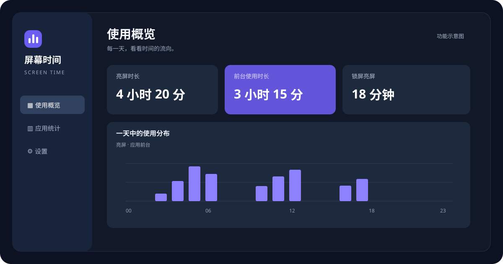
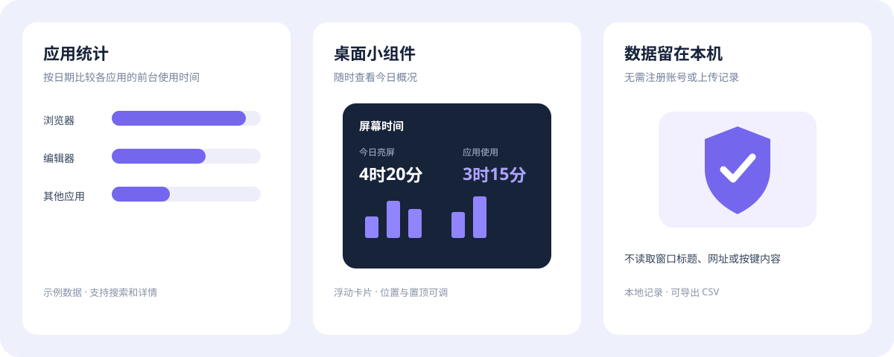

# 屏幕时间 ScreenTime

一款本地运行的 Windows 屏幕时间统计工具，记录亮屏、应用前台、活跃和多窗口可见时长。当前版本 **0.5.1**。

[下载 Windows x64 版](https://github.com/lsaac335/windows-screen-time-open-source/releases/tag/v0.5.1) · [使用说明](使用说明.md)



*界面示意图，数据为示例。*

## 功能介绍



- 按日期或近七天查看应用柱状图、排行、小时分布和应用详情；支持搜索和 CSV 导出。
- 活跃、前台、可见三种应用统计口径；可见时长支持并排窗口、多显示器，同应用的多个窗口合并计时。
- 默认显示桌面小组件，不占任务栏按钮；从托盘可找回，点击“收起”直接返回组件。
- 支持“隐藏窗口，后台记录”，关闭主面板和组件后继续采集；再次打开程序可恢复完整面板。
- 外观默认跟随 Windows 应用主题，也可手动选择浅色、深色；系统通知驱动换色，无需重启。
- 可选空闲过滤：默认 5 分钟，可设 1/3/5/10/15/30 分钟，支持按应用例外。
- 独立采集线程监听前台事件，按事件原始时间划分归属，每秒校验；主面板按需创建和释放。
- 历史缓存有界、图标按小尺寸解码；可见统计复用采集线程，只保存应用小时累计，并可独立关闭。
- 可选媒体播放和 XInput 手柄识别，默认关闭。媒体组件开启时才加载。
- 支持托盘运行、可选开机自启和自动开始记录；本软件自身排除在应用统计之外。
- 数据保存在本机，不读取窗口标题、网址、截图或按键内容，不上传使用记录。

## 如何理解统计

| 指标 | 含义 |
|---|---|
| 亮屏时长 | Windows 报告屏幕开启或变暗的时间，包含锁屏亮屏，多屏不叠加 |
| 前台时长 | 解锁亮屏时，应用获得前台焦点的累计时间，包含空闲 |
| 活跃时长 | 按记录时的空闲规则，从前台时间中扣除超过阈值的无操作区间 |
| 可见时长 | 窗口有足够区域展示在当前桌面上的估算时间，不扣键鼠空闲 |

可见统计过滤最小化、完全遮挡、其他虚拟桌面、工具覆盖层和只露很小部分的窗口。**不同应用的可见时间可以重叠，相加可能超过亮屏；同应用多个窗口不会重复累计。**透明、异形和特殊窗口按矩形估算仍可能有误差，旧日期没有采集过的可见状态无法补算。

活跃和可见都不能证明本人持续关注。媒体补计仅在系统播放来源明确匹配前台应用时生效；浏览器不能确认具体标签页，背景播放、下载不增加前台时间。手柄识别过滤死区，仅将前台应用的有效输入作为补充依据。

旧版没有保留空闲时的应用归属，因此旧日期的前台时长显示“≥”已知下限。升级会保留原统计，并在改写旧格式日文件前保存副本。可见统计使用独立文件，删除记录会同时处理对应可见时间。

## 下载使用

从 [v0.5.1 发布页](https://github.com/lsaac335/windows-screen-time-open-source/releases/tag/v0.5.1) 下载 Windows x64 压缩包，解压后运行 `ScreenTime.exe`。请保留同目录 DLL 和运行配置，不要只复制 EXE。需要 Windows Desktop Runtime 8 或兼容版本。

升级前退出旧程序并备份 `data`，替换程序文件时保留原 `data` 目录。发布包不包含使用记录或账户信息。

## 构建与验证

需要 Windows 10 1809 或更新版本、x64 与 .NET SDK 6。项目使用 WPF 和微软 Windows SDK 的 WinRT 接口，首次构建需从 nuget.org 下载依赖；成品运行不需要联网。

```powershell
.\build.ps1
```

编译结果位于 `首版` 文件夹。逻辑检查可运行：

```powershell
dotnet run --project tests/CoreTests/CoreTests.csproj -c Release
```

验证方法、资源短测和未覆盖场景见 [多窗口及后台验证](docs/validation-0.5.0.md)、[系统主题跟随验证](docs/validation-0.5.1.md)。资源占用会随界面、运行经历和数据量变化，短测不代表全天表现；此前 0.4.0 的对比记录保留在 [历史验证](docs/validation-0.4.0.md)。

## 开源许可

本项目采用 [MIT License](LICENSE)。