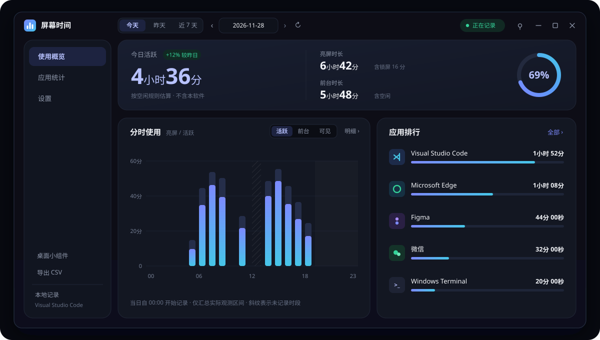
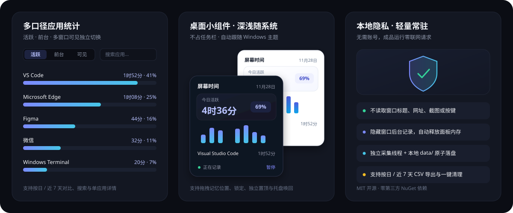

<div align="center">

# 屏幕时间 · ScreenTime

**本地优先、注重隐私、轻量常驻的 Windows 屏幕使用时间统计工具**

[简体中文](README.md) | [English](README.en.md)

[](https://github.com/lsaac335/windows-screen-time-open-source/releases/tag/v0.5.3)
[](https://github.com/lsaac335/windows-screen-time-open-source/releases/tag/v0.5.3)
[](https://dotnet.microsoft.com/download/dotnet/8.0)
[](LICENSE)

[下载 Windows x64 便携版](https://github.com/lsaac335/windows-screen-time-open-source/releases/tag/v0.5.3) · [详细使用说明](使用说明.md) · [贡献指南](CONTRIBUTING.md) · [问题反馈](https://github.com/lsaac335/windows-screen-time-open-source/issues)

</div>

---



*注：上图为功能界面示意图，图中数据均为示例。*

---

## 目录

- [项目简介](#项目简介)
- [核心功能](#核心功能)
- [统计口径说明](#统计口径说明)
- [快速开始与升级](#快速开始与升级)
- [数据存储与隐私保护](#数据存储与隐私保护)
- [技术架构与项目结构](#技术架构与项目结构)
- [从源码构建与测试](#从源码构建与测试)
- [版本演进与当前边界](#版本演进与当前边界)
- [参与贡献与开源许可](#参与贡献与开源许可)

---

## 项目简介

**屏幕时间（ScreenTime）** 是一款完全在本地运行的 Windows 桌面使用时间统计工具（当前版本 **v0.5.3**）。它帮助你清晰掌握每天的 **亮屏时长**、**应用前台时长**、**活跃时长** 以及 **多窗口可见时长**，同时严守隐私底线与低资源占用原则：

- **完全本地，零隐私侵入**：无需账号、不联网上传；不读取窗口标题、网页网址、聊天内容、屏幕截图或按键内容。
- **口径清晰，拒绝混淆**：明确区分亮屏、前台、活跃、多窗口可见四种指标，不把不同维度的时长混为一谈，也不伪造缺失时段数据。
- **原生体验，轻量常驻**：基于 WPF 与 Windows 原生接口打造，提供极简深浅双主题（支持跟随系统自动切换）、无任务栏占用的桌面小组件，以及按需创建与释放主面板的后台记录模式。

---

## 核心功能



### 1. 极简界面与可视化分析

- **概览面板**：采用 Bento 卡片布局，集中呈现当日或近 7 天的核心指标摘要、**活跃占亮屏比例环形图**、**分时使用柱状图**（支持打开时段明细窗口查看每小时/每日详情）以及带真实应用图标的 **应用排行**。
- **应用统计与对比**：支持切换 **今天 / 昨天 / 指定日期 / 近 7 天**，提供 Top 10 应用横向对比柱状图（统一零起点自适应刻度）、实时搜索筛选、完整分页列表（每页 25 项），点击任意应用可查看其当天小时分布与 7 日趋势。
- **深浅双主题与系统跟随**：内置极简黑曜石（Obsidian）深色与清爽浅色两套语义配色，默认通过系统通知实时跟随 Windows 应用主题，也可手动固定浅色或深色，主面板、小组件、标题栏与托盘菜单即时换色，无需重启。

### 2. 多维统计与精准采集

- **独立采集线程**：采集运行在独立 STA 线程中，监听 WinEvent 前台切换事件并按事件原始时间戳划分归属，配合每秒校验，不因 UI 渲染或窗口开关影响计时连续性。
- **空闲过滤与按应用例外**：默认连续 5 分钟无键鼠操作后暂停活跃计时（可选 1 / 3 / 5 / 10 / 15 / 30 分钟），支持在应用详情中为特定软件单独设置阈值，或设为“在前台时始终计时”。
- **多窗口可见时长**：支持并排分屏与多显示器场景，按屏幕范围与窗口 Z 顺序估算有效展示区域，自动过滤最小化、完全遮挡、其他虚拟桌面、工具覆盖层及仅露出极小边缘的窗口；同一应用的多个窗口合并计时，可独立关闭。
- **可选活动补充依据（默认关闭）**：
  - **媒体播放识别**：仅在开启时按需加载 Windows 媒体控制组件（WinRT），且仅当系统播放来源明确匹配当前前台应用时补计活跃时间（不读取曲名/封面，不计后台音乐）。
  - **手柄输入识别**：支持 XInput 手柄，自动过滤摇杆死区，仅在检测到有效按键、扳机或摇杆操作时为前台应用补充活动依据。
- **严谨边界处理**：自动排除本软件自身、跨午夜自动拆分、响应显示状态 / 锁屏 / 会话切换 / 电源事件，并对未记录时段以灰纹明确标示。

### 3. 桌面小组件与后台静默运行

- **独立桌面小组件**：启动默认展示极简圆角卡片，实时呈现今日亮屏、活跃、前台、小时分布与常用应用；不占用任务栏按钮，支持拖拽自动记忆位置、锁定位置、切换“桌面浮窗 / 悬浮置顶”（与主面板置顶状态相互独立）。
- **隐藏窗口，后台记录**：可在设置、小组件菜单或系统托盘中选择关闭主面板与小组件并释放界面及历史缓存，采集线程继续稳定运行；通过托盘菜单或再次启动程序即可恢复完整面板。
- **灵活启动与常驻**：支持单实例运行、系统托盘控制、可选开机自启（支持配置登录后显示小组件或仅托盘静默运行）以及可选“打开软件自动开始记录”。

---

## 统计口径说明

不同指标衡量不同维度的使用情况，**请勿将它们直接相加**：

| 指标 | 定义与统计规则 | 是否扣空闲 | 多屏 / 重叠规则 |
|---|---|---|---|
| **亮屏时长** | Windows 报告本地会话显示器处于开启或变暗状态的累计时间，包含锁屏亮屏 | 否 | 多显示器不叠加 |
| **前台时长** | 解锁且亮屏时，应用获得前台焦点的累计时间 | 否（含空闲） | 单一前台，互斥累计 |
| **活跃时长** | 按记录时的空闲规则，从前台时长中扣除超过阈值的无操作区间（可选叠加媒体/手柄补充依据） | 是 | 单一前台，互斥累计 |
| **可见时长** | 解锁且亮屏时，应用窗口有足够区域展示在当前桌面上的估算时间 | 否 | 同应用多窗口合并；**不同应用可并行叠加**，总和可超过亮屏 |

> **使用与解读提示：**
> - 正常完整记录中，通常满足 `活跃时长 ≤ 前台时长 ≤ 亮屏时长`；而各应用的 `可见时长` 之和可能大于 `亮屏时长`。
> - **活跃与可见均为估算值，不能证明本人持续注视屏幕。** 媒体补计仅在系统播放来源明确匹配前台应用时生效（浏览器无法区分具体标签页）；可见时长基于窗口矩形估算，透明、异形或特殊全屏窗口可能存在一定误差，且无法补算开启前历史日期的可见数据。
> - **旧版本兼容**：v0.3 之前的记录未保留空闲期间的前台归属，因此包含旧记录时前台时长会显示 **`≥`** 作为已知下限。升级时会自动保留原统计，并在迁移旧格式日文件前生成 `.json.pre-v2` 备份副本。

---

## 快速开始与升级

### 运行环境

- **操作系统**：Windows 10（1809 及以上）或 Windows 11（64 位 / x64）
- **运行依赖**：[.NET 8 Windows Desktop Runtime](https://dotnet.microsoft.com/download/dotnet/8.0) 或更高兼容版本（便携包不捆绑运行时）

### 下载与首次运行

1. 前往 [v0.5.3 发布页](https://github.com/lsaac335/windows-screen-time-open-source/releases/tag/v0.5.3) 下载 `ScreenTime-v0.5.3-Windows-x64.zip`。
2. 将压缩包完整解压至任意本地目录，**请保留同目录下的所有 DLL 与 JSON 运行配置文件**，不要只单独复制 `ScreenTime.exe`。
3. 双击运行 `ScreenTime.exe`。程序默认自动开始记录并显示桌面小组件；双击小组件或点击右上角按钮即可打开完整面板。

### 平滑升级与卸载

- **升级步骤**：先通过托盘菜单 **退出** 旧版本，备份程序目录下的 `data` 文件夹；用新版程序文件覆盖旧文件，同时**保留原有 `data` 目录**即可无缝延续历史记录与设置。
- **彻底移除**：若不再使用，请先在 **设置** 中关闭 **开机自启**，再完全退出程序。保留 `data` 可留存历史数据；删除整个便携目录即完成卸载。

更多界面操作、快捷键与细节说明，请查阅 [详细使用说明](使用说明.md)。

---

## 数据存储与隐私保护

### 隐私承诺

- **本地存储**：所有记录与配置均保存在程序同级的 `data/` 文件夹中，无需注册或登录，成品运行全程不需要联网。
- **最小采集原则**：仅记录应用进程标识、显示名称、小尺寸缓存图标、时间片段与系统显示/会话状态；**绝不读取**窗口标题、浏览器 URL、聊天记录、屏幕画面或键盘按键内容。

### 存储与内存策略

- **持久化机制**：界面与磁盘写入同采集线程分离，默认每 10 秒采用原子替换方式落盘；异常终止不会补记或伪造空档。
- **保留周期与缓存上限**：
  - 详细时段与可见小时记录保留 **90 天**，每日汇总保留 **365 天**。
  - 主面板收起后自动释放界面与历史缓存；内存历史最多缓存 **8 天**（并受约 10 MiB 明细预算约束，当日记录常驻），图标按小尺寸解码且最多缓存 **64 个**。
- **数据文件说明**：
  - `data/YYYY-MM-DD.json`：每日亮屏、前台与活跃统计记录。
  - `data/visibility/`：独立存放的多窗口可见小时/日累计文件（删除记录时会同步清理）。
  - `data/runtime-status.json`：当前采集状态的轻量诊断快照，并非全天历史。

### CSV 导出字段速查

可在面板中按当前选定日期或近 7 天导出 CSV（时长单位均为秒，供数据分析使用）：

| CSV 字段 | 含义说明 |
|---|---|
| `app_active` / `app_foreground` | 应用的活跃时长 / 前台时长 |
| `app_media_inferred` / `app_gamepad` | 媒体 / 手柄补充活动依据（已包含在 `app_active` 内，切勿重复相加） |
| `app_visible` | 应用的估算可见时长 |
| `visible_parallel_sum` | 允许并行重叠的所有应用可见时长合计 |
| `visibility_coverage` | 实际采集到有效窗口可见状态的覆盖时长 |

---

## 技术架构与项目结构

- **技术栈**：C# 10 / .NET 6 SDK（`net6.0-windows10.0.19041.0`，配置 `RollForward=LatestMajor` 以兼容 .NET 8+ 桌面运行时）、WPF 主界面、WinForms 系统托盘、Win32 / DWM / WTS / XInput / WinRT 原生接口。
- **零第三方 NuGet 依赖**：仅使用微软官方 Windows SDK 与 CsWinRT 运行时组件，详见 [第三方组件声明](THIRD-PARTY-NOTICES.md)。

```text
.
├── ScreenTime/                  # 主程序源码（WPF + 原生采集引擎）
│   ├── NativeTracker.cs         # 前台进程、显示状态、WTS 会话、电源事件与单调时钟
│   ├── TrackingService.cs       # 独立 STA 采集线程、WinEvent 监听与每秒采样
│   ├── WindowVisibilityMonitor.cs & VisibilityGeometry.cs  # 多窗口 Z 序矩形遮挡估算
│   ├── IdleTimeFilter.cs & ActivityEvidence.cs             # 空闲过滤、媒体与手柄补充依据
│   ├── UsageStore.cs & VisibleUsageStore.cs                # 原子落盘、有界缓存、迁移与 CSV 导出
│   ├── MainWindow.xaml(.cs) & WidgetWindow.xaml(.cs)       # 完整面板与桌面小组件
│   ├── UsageChart.cs, AppUsageBarChart.cs, ActivityRing.cs # 原生自绘图表与环形进度
│   └── ThemeManager.cs & SystemThemeMonitor.cs             # 深浅主题与 Windows 主题通知监听
├── tests/CoreTests/             # 可复现的核心逻辑、缓存预算与升级兼容性检查
├── docs/                        # 英文使用说明、界面示意图与各版本本地验证报告
├── build.ps1                    # 一键构建脚本
├── 使用说明.md                  # 完整中文使用手册
└── CONTRIBUTING.md              # 中英双语贡献指南
```

---

## 从源码构建与测试

### 构建环境

- Windows 10 1809 或更新版本（x64）
- [.NET SDK 6](https://dotnet.microsoft.com/download/dotnet/6.0)（首次构建需从 nuget.org 还原微软 Windows SDK 引用包；成品运行无需联网）

### 编译主程序

在仓库根目录的 PowerShell 中执行：

```powershell
.\build.ps1
```

默认以 `Release` 模式编译，输出位于仓库根目录的 `首版/` 文件夹（可执行文件为 `首版\ScreenTime.exe`）。

### 运行核心测试与检查

```powershell
# 运行核心计时、空闲过滤、设置、事件时钟、活动依据与可见性逻辑测试
dotnet run --project tests/CoreTests/CoreTests.csproj -c Release

# 运行内存缓存预算与写入恢复检查
dotnet run --project tests/CoreTests/CoreTests.csproj -c Release -- --check-cache-budget
```

### 验证报告参考

详细的验证方法、资源占用短测数据与未覆盖场景说明，请参阅各版本本地验证记录：

- [多窗口可见时间与后台模式验证（v0.5.0）](docs/validation-0.5.0.md)
- [系统主题跟随验证（v0.5.1）](docs/validation-0.5.1.md)
- [历史资源占用对比记录（v0.4.0）](docs/validation-0.4.0.md)

*注：实际内存与 CPU 占用会随打开的视图、运行经历与历史数据量变化，短时测试结果不代表全天 24 小时运行表现。*

---

## 版本演进与当前边界

### 近期版本亮点

- **v0.5.3**：全新极简黑曜石（Obsidian）视觉界面、更完善的真实应用图标展示、图表与界面性能优化。
- **v0.5.2**：焕新 Windows 风格界面、新增活跃占比环形图（ActivityRing）、分时明细窗口与自定义深浅色托盘菜单。
- **v0.5.1**：新增外观跟随 Windows 系统主题（系统通知驱动，零轮询即时换色）。
- **v0.5.0**：新增多窗口/多显示器可见时长统计、无任务栏小组件与“隐藏窗口，后台记录”模式。
- **v0.4.0**：按需创建与释放主面板、有界历史与图标缓存、可选媒体播放与 XInput 手柄活动依据。
- **v0.3.0**：独立采集线程、前台事件原始时间戳归属、拆分前台与活跃双指标、按应用空闲规则。

### 当前版本边界

本项目目前聚焦于**准确、克制、低打扰的本地时长记录**，暂不包含以下功能：

- 应用分类标签、每日使用限额、强制锁屏或休息提醒
- 浏览器具体网站 / 标签页级统计
- 账号体系与云端跨设备同步
- 安装向导（MSI/MSIX）与代码签名证书

---

## 参与贡献与开源许可

- **参与贡献**：欢迎提交 Bug 报告、功能建议、文档改进或 Pull Request！请先 Fork 本仓库，在自己的分支完成修改与验证后向 `main` 提交 PR。详细规范见 [贡献指南 / Contributing](CONTRIBUTING.md)。
- **开源许可**：本项目源码基于 [MIT License](LICENSE) 开源；随附微软运行组件的许可说明见 [第三方组件声明](THIRD-PARTY-NOTICES.md)。
